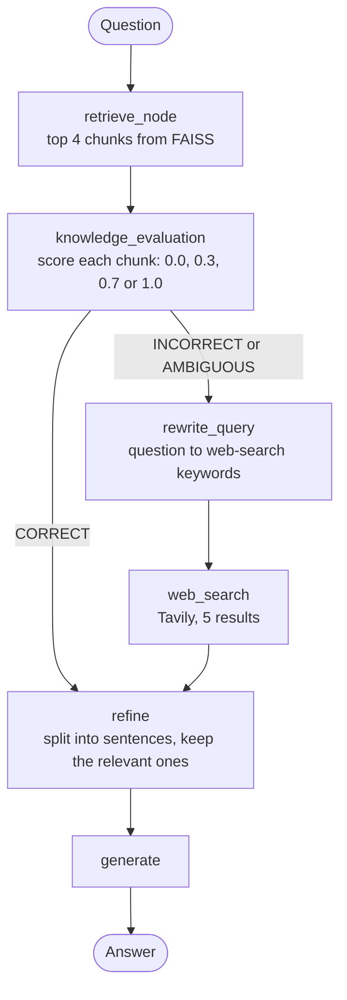
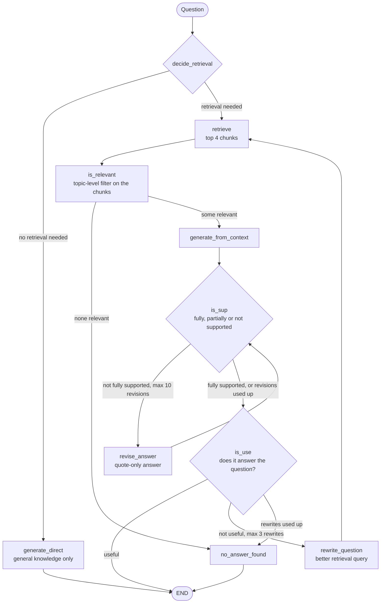

# Advanced RAG on a PDF: Corrective RAG and Self-RAG

Two question-answering pipelines built with [LangGraph](https://langchain-ai.github.io/langgraph/) over the same document, `world_history_detailed_expanded_60_pages.pdf`, a 60-page world history study guide that runs from early humans to globalisation.

Both pipelines run locally with Llama 3.2 (3B) through Ollama. They differ in how they check and repair weak retrieval and weak answers:

| | `CRAG_pdf_qna.ipynb` | `self_RAG.ipynb` |
|---|---|---|
| **Idea** | Corrective RAG: grade the retrieved chunks and fall back to web search when retrieval is weak | Self-RAG: decide whether retrieval is needed, then verify that the answer is supported and useful |
| **What it checks** | Relevance of each retrieved chunk, before generating | Relevance of the documents, whether the answer is supported by them (IsSUP), and whether it answers the question (IsUSE) |
| **When things go wrong** | Rewrites the question and searches the web (Tavily) | Revises the answer, rewrites the question and retries retrieval, then gives up with "No answer found." |
| **Needs a Tavily key** | Yes | No |

## Shared pipeline

Both notebooks start from the same retrieval setup:

1. **Load** the PDF with `PyPDFLoader`
2. **Split** into chunks with `RecursiveCharacterTextSplitter` (chunk size 900, overlap 150)
3. **Embed** with `BAAI/bge-small-en-v1.5` (384 dimensions, normalized, on CPU) via `langchain-huggingface`
4. **Index** in FAISS (in memory, rebuilt on every run)
5. **Retrieve** with similarity search, top 4 chunks
6. **Generate and grade** with `llama3.2:3b` through Ollama (`temperature=0`). Every grading step returns structured output defined by a Pydantic model.

## 1. Corrective RAG (`CRAG_pdf_qna.ipynb`)



**Evaluating the retrieved chunks.** An LLM scores each chunk against the question (1.0 answers it on its own, 0.7 has part of the answer, 0.3 is on topic but unhelpful, 0.0 is unrelated). The scores set a verdict:

| Verdict | Rule | What happens next |
|---|---|---|
| `CORRECT` | at least one chunk scores 0.7 or higher | answer from the good local chunks only |
| `INCORRECT` | every chunk scores 0.3 or lower | discard the local chunks and use web search results |
| `AMBIGUOUS` | anything in between | use the web search results, combined with any good local chunks |

**Web search.** On `INCORRECT` or `AMBIGUOUS`, the question is rewritten into a short keyword query (6 to 14 words, with a recency constraint if the question implies one), and Tavily returns up to 5 results.

**Refining.** The selected documents are split into sentences ("knowledge strips"). The LLM keeps only the strips useful for the question, without rewriting them, and the answer is generated from those strips alone.

Example run: for *"explain Second World War"* the evaluator returned `CORRECT`, and the answer was built from the PDF's own chunks.

## 2. Self-RAG (`self_RAG.ipynb`)



The pipeline has four checkpoints, loosely following the Self-RAG paper:

- **Retrieve?** `decide_retrieval` decides whether the question needs facts from the document or can be answered from general knowledge. When unsure, it retrieves.
- **Relevant?** `is_relevant` keeps chunks that cover the same topic as the question. It does not require the exact answer to be present.
- **Supported? (IsSUP)** `is_sup` checks the draft answer against the retrieved context and labels it `fully_supported`, `partially_supported` or `no_support`, quoting up to three pieces of evidence. The check is strict: any interpretive wording that isn't in the context downgrades the answer to `partially_supported`. Anything below `fully_supported` goes to `revise_answer`, which rewrites the answer as direct quotes from the context. This loop runs at most 10 times.
- **Useful? (IsUSE)** `is_use` judges whether the answer addresses what was asked. If not, `rewrite_question` produces a keyword-style retrieval query and the pipeline retrieves again, up to 3 rewrites, before answering "No answer found."

The last cell of the notebook is an interactive chat loop. Type a question at the prompt, and type `END` to exit. Example questions from my testing: *"explain history of Maurya and Gupta empires"* and *"explain Second World War"*.

## Setup

**Prerequisites:** Python 3.10+ and [Ollama](https://ollama.com).

```bash
# 1. Install the Python dependencies
pip install -r requirements.txt

# 2. Download the local LLM and make sure Ollama is running
ollama pull llama3.2:3b

# 3. (CRAG notebook only) add your Tavily key
cp .env.example .env          # on Windows: copy .env.example .env
# then edit .env and set TAVILY_API_KEY=<your key>
```

Then open either notebook in Jupyter and run the cells in order. The first run downloads the embedding model (about 133 MB). Ollama must be running while the notebooks execute, otherwise the first LLM call fails with a connection error.

A free Tavily key is available at [tavily.com](https://tavily.com). The Self-RAG notebook does not use it.

## Repository contents

```
.
├── CRAG_pdf_qna.ipynb                              # Corrective RAG pipeline
├── self_RAG.ipynb                                  # Self-RAG pipeline
├── world_history_detailed_expanded_60_pages.pdf    # the document both pipelines answer questions about
├── requirements.txt
├── .env.example                                    # template for your API key
└── README.md
```

## Notes and limitations

- **A 3B model is a rough judge.** All grading (chunk scores, support, usefulness) is done by Llama 3.2 3B, so verdicts can be inconsistent. The thresholds (0.7 and 0.3) and the strict IsSUP rules are starting points to tune, and a larger model would grade more reliably.
- **Prompt-based, not fine-tuned.** The original CRAG paper trains a dedicated retrieval evaluator, and the original Self-RAG paper fine-tunes the model to emit reflection tokens. These notebooks reproduce the control flow with prompts on a general-purpose LLM, so treat them as learning implementations, not reproductions of the papers' results.
- **Web search leaves the document.** When CRAG falls back to Tavily, the answer comes from the open web and may not match the PDF.
- **No persistence.** The FAISS index is rebuilt in memory every time a notebook runs.

## References

- Yan et al., *Corrective Retrieval Augmented Generation* (2024): https://arxiv.org/abs/2401.15884
- Asai et al., *Self-RAG: Learning to Retrieve, Generate, and Critique through Self-Reflection* (2023): https://arxiv.org/abs/2310.11511
